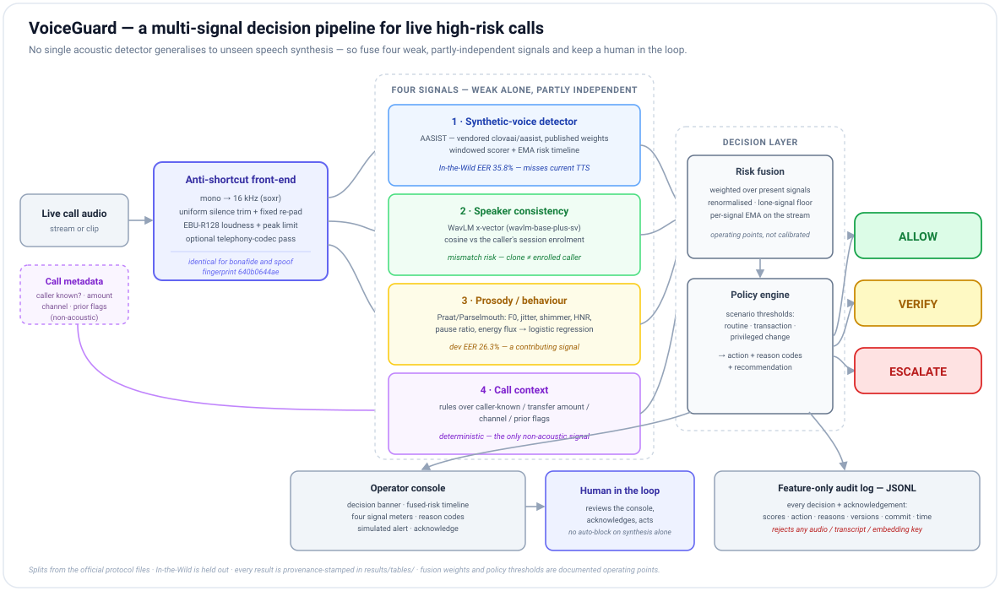

# VoiceGuard

**A multi-signal voice-integrity layer for high-risk phone calls, and an honest
measurement of where synthetic-speech detection actually stands.**

Smart India Hackathon 2026, problem SIH26104 (AICTE Cyber Security Cell). The
brief asks for a real-time system that detects cloned/synthetic speech, verifies
the claimed speaker, measures behavioural anomalies, and recommends action before
a transaction — with a privacy-preserving design and Indian-language support.

This repository takes the position that **no single acoustic detector generalises
to unseen speech synthesis**, and builds around that fact rather than against it.

**New to this repo?** [`GETTING_STARTED.md`](GETTING_STARTED.md) walks through
getting it running on your own machine from a fresh clone — installing
libraries, downloading the dataset, running the live demo, and (optionally)
training — with every command spelled out. Everything below is the
research-oriented account of the work.

---

## 1. Motivation

Published anti-spoofing countermeasures report sub-1% Equal Error Rate (EER) on
ASVspoof 2019. Those numbers do not survive contact with real audio:

- Müller et al. (2022), *"Does Audio Deepfake Detection Generalize?"* — up to
  **1000% relative degradation** on found ("In-the-Wild") audio.
- We reproduce this. The strongest published model we tested (AASIST) drops from
  **~1% published EER to 35.8% EER** on In-the-Wild once evaluated honestly, and
  a current text-to-speech model (Meta MMS-TTS, English) is flagged only **8% of
  the time**.

A product that stakes its decision on one such detector fails silently the first
time it meets a generator it wasn't trained on. VoiceGuard instead fuses four
weak-but-partly-independent signals and keeps a human in the loop.

---

## 2. What has been done



<sub>Figure style adapted from the pipeline diagram in Sun et al.,
[*AI-Synthesized Voice Detection Using Neural Vocoder Artifacts*](https://arxiv.org/abs/2304.13085)
(CVPRW 2023). The architecture shown is VoiceGuard's own.</sub>

> One anti-shortcut front-end feeds four weak, partly-independent signals
> (§2.2). `voiceguard.risk` fuses the signals that are present and a policy
> table turns the fused score into **ALLOW / VERIFY / ESCALATE** with reason
> codes (§2.3). Every decision is written to a feature-only audit log and shown
> in the operator console; a human acknowledges and acts. The subsections below
> take each stage in turn.

### 2.1 A trustworthy evaluation harness (the core methodological contribution)

The ASVspoof 2019 LA corpus contains a **silence-duration / loudness artifact**:
bonafide and spoof clips differ systematically in leading/trailing silence. A
model can score well by learning that artifact instead of synthesis.

We measured it: a classifier trained on our earlier pipeline scored **13–15% EER
using *only the non-speech regions* of dev clips** (chance = 50%). Its apparent
1.83% EER was mostly the artifact.

The fix (`voiceguard.audio`, [`docs/evaluation_protocol.md`](docs/evaluation_protocol.md)):

1. every audio path — features, training, inference — loads through one
   front-end: mono → 16 kHz → uniform silence trim + fixed re-pad →
   EBU-R128 loudness normalisation → peak limit, **identical for both classes**;
2. the front-end settings hash to a 10-char `front_end` fingerprint stamped on
   every result row; numbers with different fingerprints never share a table;
3. a **permanent silence-ablation gate**: after any model change, EER on
   silence-only input must be within ~5 points of 50%. Below 40% ⇒ leak ⇒ stop.

After the fix, silence-only EER is **55–61%** (GBM) / **41%** (AASIST) — the
models are keying on speech, not the artifact.

Splits come from the official protocol files only. **In-the-Wild is never trained
on and never used to pick a threshold.** Every table reports the flattering
in-domain number and the honest cross-dataset number side by side.

### 2.2 Detection signals

| Signal | Implementation | Standalone performance |
|---|---|---|
| **Synthetic-voice** | AASIST (vendored `clovaai/aasist`), published weights, run through the front-end | dev (known) **9.6%** · eval (unknown) **23.3%** · In-the-Wild **35.8%** EER |
| **Speaker consistency** | WavLM x-vector (`microsoft/wavlm-base-plus-sv`), per-session enrolment, cosine similarity → mismatch risk | same-speaker cosine ≈ 0.95+ on ≥ 6 s enrolment; Platt-calibrated, held-out speakers ECE 0.389→0.181 |
| **Prosody / behaviour** | Praat/Parselmouth features (F0 stats, jitter, shimmer, HNR, pause ratio, energy flux) + logistic regression on ASVspoof-train | **26.3%** dev EER — weak by design, a contributing signal |
| **Call context** | rules over caller-known / transfer amount / prior flags / channel | deterministic |

Also implemented and unit-tested but **not yet trained at scale**: RawNet2,
AASIST-L, SSL-AASIST (frozen wav2vec2 / XLS-R front-end + AASIST graph back-end);
RawBoost + telephony-codec augmentation; a resumable training loop
(`scripts/train_cm.py`). A 2-epoch local run confirms the code trains correctly
(dev EER 34.1% → 26.6%); full training is a compute problem, not a code problem
(see §5).

### 2.3 Fusion, policy, and the operator layer

- **`voiceguard.risk`** — a **channel-aware learned fusion** (`risk/learned.py`,
  fitted parameters in `models/fusion/fusion.json`): a clone head (spoof score ×
  noise descriptors) and an impostor head (speaker score × noise descriptors)
  combined as independent alarms, with call context as a third. Conditioning on
  the channel is what stops a genuine caller with background voices from being
  flagged as synthetic. A policy table then maps the fused score to
  **ALLOW / VERIFY / ESCALATE** under three scenarios (routine call, transaction,
  privileged change), with plain-English reason codes. Fitted and measured with
  speaker-disjoint cross-validation — see [`docs/system_eval.md`](docs/system_eval.md).
  The earlier hand-set weighted mean (`risk.fuse`) remains the fallback when no
  `fusion.json` is present. Prosody is shown but no longer a decision input
  (≈ chance on the system trials); it is not computed by default (saves ~165 ms per
  assessment) — `serve_demo.py --prosody` / `serve_grpc.py --prosody` bring the meter back.
- **`voiceguard.audit`** — feature-only JSONL log: scores, action, reasons,
  model version, front-end fingerprint, git commit, timestamp. It **rejects any
  key** that would carry audio, a transcript, or an embedding. Retention horizon
  + prune. This is the privacy posture.
- **`voiceguard.serve`** — a FastAPI session API (`POST /api/session`, `enroll`,
  `context`, `analyze`, `acknowledge`, `WS .../stream`, `GET .../audit`) and a
  single-page **operator console** (`/`): decision banner, fused-risk timeline,
  four signal meters, reason codes, editable call context, a simulated alert +
  acknowledge, and the live audit trail. `examples/rest_client.py` drives the
  whole flow headless. The same session API is also reachable over **gRPC**
  (`voiceguard.serve.grpc_service`, `scripts/serve_grpc.py`,
  `examples/grpc_client.py`) — one decision engine, two transports; see
  [`docs/grpc.md`](docs/grpc.md).

### 2.4 Per-language evaluation (IndicCall-Eval, pilot)

`scripts/make_indic_spoof.py` generates MMS-TTS attacks in **English, Hindi,
Tamil, Bengali, Marathi**; `scripts/eval_indic.py` scores them per language.

| language | detector flags the synthetic clip | mean prosody score |
|---|--:|--:|
| Marathi | **85%** | 63% |
| Hindi | 58% | 55% |
| Tamil | 55% | 73% |
| Bengali | 38% | 43% |
| English | **8%** | 47% |

The detector was trained **only on English** ASVspoof 2019, yet flags
Indian-language synthesis *more* often than English synthesis — non-English TTS
sits further from the "natural English" distribution the model learned, so its
artefacts trip the detector more. Uneven, measured, per-language — **not** a
"supports all Indian languages" claim. The consented real-speech slice (protocol
in [`docs/indic_eval.md`](docs/indic_eval.md)) is what turns recall into a
per-language EER; the team records it.

---

## 3. Key results

All numbers follow [`docs/evaluation_protocol.md`](docs/evaluation_protocol.md)
and carry provenance in `results/tables/`. Front-end fingerprint `640b0644ae`,
seed 42, trained on `asvspoof19_la_train`.

| System | dev EER (known A01–06) | eval EER (unknown A07–19) | **In-the-Wild EER** | silence-only EER |
|---|--:|--:|--:|--:|
| Handcrafted 61-dim + GBM ensemble (Gen-1 baseline) | 7.0% | 33.4% | 58.2% | 59.0% (≈ chance ✓) |
| **AASIST, published weights, our front-end** | 9.6% | **23.3%** | **35.8%** | 41.3% (≈ chance ✓) |

- AASIST's dev EER (9.6%, vs its published ~1%) is *worse* through our front-end
  because the front-end strips the silence artifact it had partly learned. The
  honest score is the higher one.
- In-the-Wild **58.2% → 35.8%** is the one improvement that matters (a
  cross-dataset test the model never saw). It is still far from deployable
  (target < 15%).
- Per-attack (AASIST eval): near-perfect on A08/A09 (< 2%), fails on A10/A12
  (44–52%) — unfamiliar neural vocoders. Full breakdown in
  `results/tables/cm_aasist-pretrained_in_domain.csv`.

**min-tDCF** (the ASVspoof community's own deployment-oriented metric — a
countermeasure scored in tandem with a fixed ASV system under an explicit
cost model, using the organizers' reference implementation and their
baseline ASV system's scores; 0 = perfect, 1 = no better than no
countermeasure at all — see [`docs/tdcf.md`](docs/tdcf.md)):

| System | dev min-tDCF | eval min-tDCF |
|---|--:|--:|
| **AASIST, published weights, our front-end** | 0.288 | **0.588** |

Same story as EER, from a different, independently-computed metric: usable
on known attacks, collapses on unseen ones. ASVspoof 2021 DF, a second
held-out cross-dataset test, is *not* built — the corpus needs a
registration step we haven't done yet (see `docs/tdcf.md`).

**System accuracy (fused decision, in the situations real calls come from).** Each
call is replayed under 19 situations: clean, background voices at two levels,
broadband noise, four phone codecs, room reverberation, speakerphone, narrow band,
clipping, low level, packet loss, mains hum, music, bursts, and two compound cases.
On speakers the model never saw, the shipped fusion decides **90.8 %** of calls
correctly (balanced accuracy **90.2 %**; the spoof score alone is 73.6 % balanced and
the hand-set fusion 83.9 %) and **92.4 %** on a never-fitted `dev` split (genuine callers
accepted 90.5 %, clones caught 97.6 %, genuine ESCALATE 1.3 %). The clone check is
*trust-weighted* since 2026-10-23: the recording style can only change how far the detector
is believed, never raise an alarm on its own, because a real WhatsApp voice note was called
fake by the previous version ([`docs/real_world_audio.md`](docs/real_world_audio.md); the old head
scored 93.1 % / 92.7 % on these two, by partly reading the style of ASVspoof's recordings).
The detector was made robust in two steps by `scripts/finetune_robust.py` (dev EER at
5 dB babble **48.2 % → 27.0 %**, then **17.8 % → 13.2 %** measured in the order a real call
reaches the model, hence the different starting value); four more channel descriptors let the
fusion tell reverberation, clipping and mains hum from synthesis.

**What it does in a place nobody planned for.** Fourteen of those situations were first
measured on a system that had never seen them: balanced accuracy **78.6 %**, genuine callers
accepted **63 %**, and with a clipped microphone only 8 %. After the fixes, with the situation
held out of the fit as well as the speaker, it is **86.6 %** balanced and **79 %** accepted
([`docs/stress_eval.md`](docs/stress_eval.md)). That 87 %, not the 90 %, is the number to plan
with for a situation that is not on the list. Weakest cases: a noisy room followed by a
mobile codec (60 % of genuine callers accepted) and a clipped microphone the system has
never met. All degradations are synthetic, not recordings. Full method, tables and limits:
[`docs/system_eval.md`](docs/system_eval.md), [`docs/stress_eval.md`](docs/stress_eval.md).

**Input that is not a voice.** A quality gate (`audio/quality.py`, a Silero speech check)
sits in front of every transport. Silence, a muted line, tones, noise and clips with under
a second of speech get a **WAITING** verdict instead of a guess, never a false ALLOW or a
false alarm; corrupt, clipped or wrongly scaled audio is repaired or refused; enrolment
needs 3 s of real speech ([`docs/input_quality.md`](docs/input_quality.md)).

**The system-level result against modern clones**
([`docs/modern_attacks.md`](docs/modern_attacks.md)): zero-shot voice conversion (kNN-VC) of a
target speaker is flagged on **71-75 % of clean-line calls** (single reads, 68 distinct calls over
dev and eval) and **83-100 %** under background voices or a phone codec; synthetic MMS-TTS speech
is flagged on all of them. Until 2026-10-23 it was 100 %, but that head partly read the *recording
style* (a clean floor, little high-frequency energy), which a real WhatsApp voice note shares, so it
was replaced ([`docs/real_world_audio.md`](docs/real_world_audio.md)) and the clean-line number is
the honest one. In an earlier 80-call sweep with 12-107 s of the customer's voice as reference
(old head, 92.5 % flagged) more reference audio did not help the attacker, but a clone that
sounded closer to the customer got through more often. A cheaper SpeechT5 clone gets **about half**
of its calls through. The honest reading: the acoustic detector sees only 2-3 % of these clones.
They are caught by the speaker-consistency check (the clone is not quite the enrolled customer)
and, on noisy lines, by the detector. A clone that matches the enrolled voice as well as the real
speaker does would pass, so treat speaker verification as the real control and the detector as
support. The console's sample "cloned with a free tool" call is deliberately one of the hard
ones, and the system lets it through with a note. Training the detector on these generators is
the next step.

---

## 4. Reproduce

```bash
python -m venv myenv
myenv/Scripts/activate                 # Windows; source myenv/bin/activate elsewhere
pip install -e ".[baseline,dl,dev]"    # + ",serve,prosody" for the console
```

Python 3.11. `ffmpeg` on `PATH` for the codec pass.

**Data** (not in git — place at the `config/default.yaml` paths):
`ASVspoof 2019 LA` → `data/raw/LA/LA/`, `In-the-Wild` →
`data/external/in_the_wild/extracted/release_in_the_wild/`, then:

```bash
python scripts/build_manifests.py      # manifests = the single source of truth
python scripts/train_baseline.py       # Gen-1 baseline
python scripts/run_eval.py             # baseline_*.csv (incl. the silence gate)
python scripts/eval_cm.py --model aasist --pretrained   # AASIST through the front-end
python scripts/eval_tdcf.py --model aasist --pretrained # cm_*_tdcf.csv (needs the LA asv_scores/ files)
python scripts/train_prosody.py        # models/prosody/prosody_lr.joblib (tracked, 2 KB)
```

**The console demo** ([`docs/demo_runbook.md`](docs/demo_runbook.md)):

```bash
pip install -e ".[dl,serve,prosody]"
python scripts/pick_demo_clips.py      # demo_audio/{enrol,benign,cloned}.wav from ASVspoof
python scripts/serve_demo.py           # http://127.0.0.1:8000  (console) + /detector
```

**Same session, over gRPC instead** ([`docs/grpc.md`](docs/grpc.md)):

```bash
pip install -e ".[dl,serve,prosody,grpc]"
python scripts/serve_grpc.py           # 127.0.0.1:50051, in a second terminal
python examples/grpc_client.py demo_audio/enrol.wav demo_audio/benign.wav demo_audio/cloned_1.wav
```

**Per-language pilot:**

```bash
pip install -e ".[research]"
python scripts/make_indic_spoof.py --per-lang 40
python scripts/eval_indic.py           # results/tables/indic_eval.csv
```

**Situations beyond the standard five** ([`docs/stress_eval.md`](docs/stress_eval.md)):

```bash
python scripts/finetune_robust.py --aug v2 --init AASIST_robust.pth --out AASIST_robust2.pth --epochs 6 --per-class 4000 --workers 4   # resumable
python scripts/eval_cm.py --model aasist --weights AASIST_robust2.pth --limit-per-class 6000       # incl. the silence gate
python scripts/build_system_trials.py --split eval --tag _r2  --weights AASIST_robust2.pth         # + dev; --conds stress --tag _r2s
python scripts/fit_fusion.py --tag _r2,_r2s --esc-fpr 0.03 --channel dyn_db,floor_rel_db,hf_ratio,flatness,env_acf,crest_db,flat_top_db,hum_db
python scripts/eval_stress.py --tag _r2s --split dev
```

268 unit tests (`pytest -q`) — metrics, front-end, manifests, models, speaker,
prosody, risk fusion, audit, the session API (REST and gRPC), VAD, input-quality gate,
calibration, min-tDCF, channel features, learned fusion and its fitting, degradations,
trial design, the fine-tune data pipeline, the call-level policy evaluator.

---

## 5. Limitations and what is not done

- **The detector is not good enough on audio from outside the lab.** The model is the
  published AASIST fine-tuned here for noise, rooms and phone lines; it is far better in
  those situations, but its In-the-Wild EER is still 36.2 %, which is not deployable, and
  its 20 % ASVspoof eval EER shows the same weakness on unseen synthesis methods. Full
  training does not fit the development laptop (≈ 50 min/epoch, 30–40 epochs
  needed); it is set up to run on a Kaggle T4 — see
  [`docs/training_runbook.md`](docs/training_runbook.md) for the concrete
  setup and why AASIST, not SSL-AASIST, should be trained first.
- **Every degradation in the evaluation is synthetic.** Reverb, hum, clipping, packet loss
  and codecs are simulated on studio speech; the system has not been measured on recordings of
  real rooms, cars or networks. The weakest measured case is a noisy room followed by a
  mobile codec (65 % of genuine callers accepted).
- **Long unattended runs need the laptop awake.** It went to sleep for almost two hours
  during the last run; every job here is resumable (`--resume`), but disable sleep while
  plugged in for multi-hour work.
- **Calibration measured, not assumed — and it only held up for one signal
  of three.** Speaker consistency ships a Platt calibrator verified to
  generalize to held-out speakers (ECE 0.389→0.181). Spoof and prosody
  calibrators were fit and measured the same way, and *made things worse*
  on unseen attacks / cross-dataset audio, so neither ships; both stay on
  their pre-existing ad-hoc operating points. See
  [`docs/calibration.md`](docs/calibration.md).
- **Latency.** The acoustic model still needs a 4.04 s window for a
  *confirmed* read — not built shorter. What is built: speech-onset VAD
  (latency measured from when the caller starts talking, not call-connect)
  and safety-capped provisional reads (a short/tiled-window score is marked
  `provisional` and capped at VERIFY, never a silent ESCALATE, until a full
  window confirms it). See [`docs/latency.md`](docs/latency.md).
- **Alerts are simulated** in the console; no real SMS/email/webhook sink.
- **IndicCall-Eval** has the synthetic side and the harness; the consented
  real-speech slice is pending.
- **gRPC + SDK** now ships (`voiceguard.serve.grpc_service`,
  `examples/grpc_client.py`) alongside REST/WS — same `SessionManager`,
  verified to produce identical decisions on the same clip. See
  [`docs/grpc.md`](docs/grpc.md).
- **Model card** now ships at
  [`models/pretrained/MODEL_CARD.md`](models/pretrained/MODEL_CARD.md).
  It documents a real gap while doing so: **this repository has no
  top-level LICENSE file yet** — the vendored AASIST/RawBoost code carries
  its own upstream terms, but this project's own code doesn't declare one.
  Not a decision this pass makes unilaterally.
- **Not started:** on-device/edge inference, MUSAN/RIR augmentation,
  ASVspoof 2021 DF as a second eval set (see [`docs/tdcf.md`](docs/tdcf.md)),
  real alert delivery (SMS/email/webhook — the console panel is simulated),
  auth/TLS hardening for the REST and gRPC servers (both currently bind to
  localhost only, by design, not yet a gap being closed).

Roadmap and phase status: [`docs/project_status.md`](docs/project_status.md).

---

## 6. Repository layout

```
src/voiceguard/
  audio/       anti-shortcut front-end (load, trim, loudness, codec) + augmentation;
               speech-onset VAD (vad.py); input-quality gate (quality.py); the 14 shared
               degradations (degrade.py); channel descriptors (channel.py)
  data/        manifest build + load (repo-relative, portable)
  features/    handcrafted 61-dim features (Gen-1 baseline only)
  models/      baseline GBM; RawNet2 / AASIST / AASIST-L / SSL-AASIST (vendored refs)
  eval/        EER / DET metrics, calibration (ECE/Brier/Platt/isotonic), min-tDCF
               (reference impl vendored in _vendor/), provenance stamping, harness;
               trials.py = the shared genuine / clone / impostor trial design
  detect/      windowed CMScorer + EMA risk timeline
  speaker/     WavLM x-vector enrolment + per-session consistency check (calibrated)
  prosody/     Praat features + logistic-regression scorer
  risk/        signal fusion + policy engine (ALLOW / VERIFY / ESCALATE)
  audit.py     feature-only audit log
  serve/       session REST/WS API + operator console (FastAPI, localhost only);
               grpc_service.py + proto/ for the gRPC transport (same SessionManager)
config/        default.yaml — the only place any path is written
examples/      rest_client.py + grpc_client.py — same flow, two transports
notebooks/     kaggle_train_cm.ipynb — runnable Kaggle trainer (item c); 00-05 are
               pre-P0 exploration, superseded, kept for reference only (see its README)
scripts/       build_manifests, train_baseline, train_cm, train_prosody, run_eval,
               eval_cm, eval_indic, make_indic_spoof, make_modern_spoof,
               finetune_modern, pick_demo_clips, prep_demo_call, serve_demo, serve_grpc,
               demo*, calibrate_cm, calibrate_prosody, calibrate_speaker, eval_tdcf;
               finetune_robust, build_system_trials, fit_fusion, eval_stress (system
               accuracy in 19 situations); build_stream_trials + eval_stream (time to
               alert and false alarms over a whole call); make_modern_clones +
               build_modern_trials (kNN-VC / SpeechT5 / MMS attacks); eval_speaker_models;
               eval_clone_effort + make_demo_clone (how much reference audio a clone needs);
               make_poster_figures (the poster / viva charts from results/tables);
               make_poster (the A1 poster, PDF + PNG, from the same tables) with
               capture_console_shots (real console screens) and qrcode_svg (the QR code)
docs/          evaluation_protocol.md (frozen), baseline_results.md, project_status.md,
               demo_runbook.md, indic_eval.md, initial-review.md, calibration.md,
               latency.md, tdcf.md, grpc.md, training_runbook.md, system_eval.md,
               stress_eval.md, input_quality.md, modern_attacks.md, real_world_audio.md;
               poster_content.md + poster_figures/ (poster text and figures),
               poster/ (the finished A1 poster: voiceguard_poster_A1.pdf / .png / .html),
               viva_notes.md (what to say in the viva)
models/        pretrained/ (+ MODEL_CARD.md) + prosody/ + speaker/ weights and
               calibrators, committed; everything else under models/ (training
               checkpoints) is gitignored
paper/         IEEE-style writeup (tex/pdf/docx) + slide deck
results/tables/ every metric, provenance-stamped, committed
tests/         268 unit tests
```

Vendored reference implementations (`src/voiceguard/models/_vendor/`) retain their
upstream licenses: AASIST/RawNet2 from `clovaai/aasist`, RawBoost from
`TakHemlata/RawBoost-antispoofing`.

---

## 7. References

- Jung et al., *AASIST: Audio Anti-Spoofing using Integrated Spectro-Temporal
  Graph Attention Networks*, ICASSP 2022.
- Müller et al., *Does Audio Deepfake Detection Generalize?*, Interspeech 2022
  (In-the-Wild dataset).
- Tak et al., *RawBoost: A Raw Data Boosting and Augmentation Method for Speech
  Anti-Spoofing*, ICASSP 2022.
- Chen et al., *WavLM: Large-Scale Self-Supervised Pre-Training for Full Stack
  Speech Processing*, 2022.
- Wang et al., *ASVspoof 2019: A Large-Scale Public Database of Synthesized,
  Converted and Replayed Speech*.
- Pratap et al., *Scaling Speech Technology to 1,000+ Languages* (Meta MMS).
